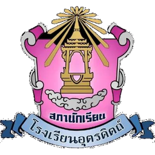
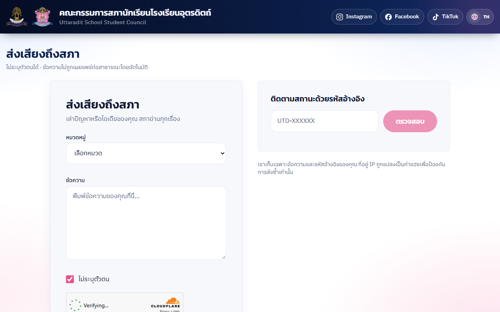
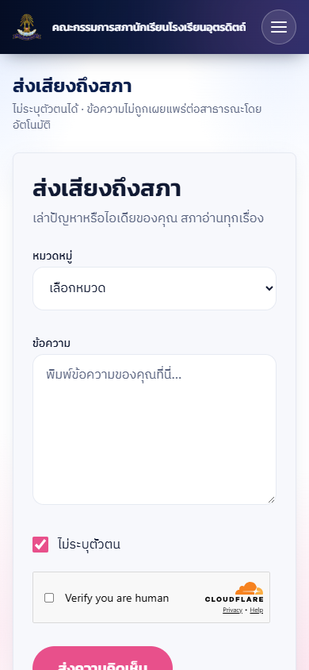
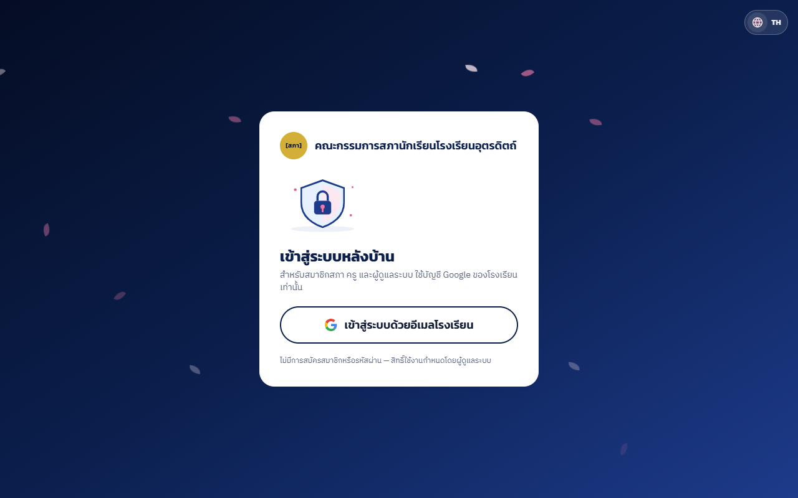
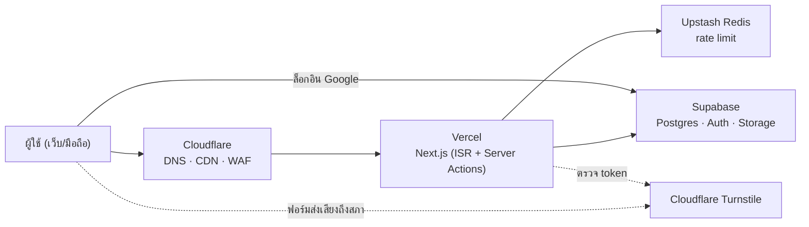
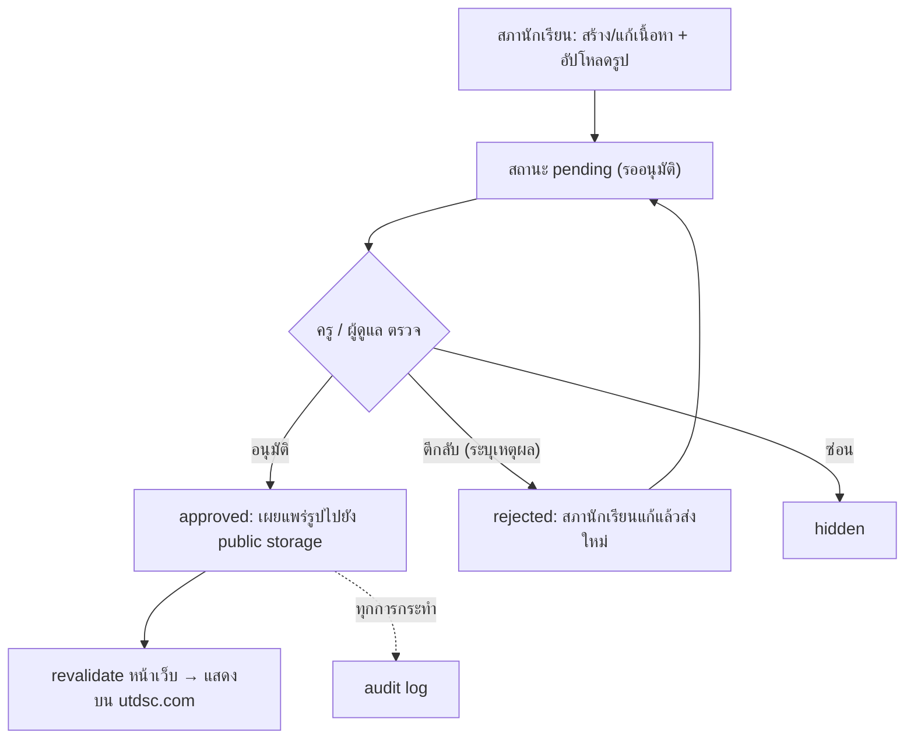

<div align="center">

<picture>
  <source media="(prefers-color-scheme: dark)" srcset="./public/brand/logo-council-256.png">
  <source media="(prefers-color-scheme: light)" srcset="./public/brand/logo-council-256.png">
  
</picture>

# สภานักเรียนโรงเรียนอุตรดิตถ์ · Uttaradit School Student Council

เว็บไซต์ทางการของคณะกรรมการสภานักเรียน — ข่าวสาร นโยบาย และคณะกรรมการ ในหน้าเดียว สองภาษา
<br>*The official website of the Uttaradit School Student Council — news, policies and members on one bilingual page.*

**[utdsc.com](https://utdsc.com)**


</div>

---

## 📌 ภาพรวม · About

เว็บไซต์ของสภานักเรียนโรงเรียนอุตรดิตถ์ รวมกิจกรรม ข่าวประชาสัมพันธ์ นโยบายพร้อมความคืบหน้า และข้อมูลคณะกรรมการ/ครูที่ปรึกษา
แยกตามปีการศึกษา ไว้ในหน้าเดียวแบบแท็บ อ่านได้ทั้งภาษาไทยและอังกฤษ
เนื้อหาทั้งหมดจัดการผ่านระบบหลังบ้าน: สภานักเรียนเป็นผู้ส่งเนื้อหา ครู/ผู้ดูแลเป็นผู้อนุมัติก่อนเผยแพร่
มีช่องทาง "ส่งเสียงถึงสภา" ให้นักเรียนส่งความคิดเห็นแบบไม่ระบุตัวตนและติดตามสถานะด้วยรหัสอ้างอิง

## ✨ ฟีเจอร์เด่น · Features

| ฟีเจอร์ | รายละเอียด |
|---|---|
| 🗂️ หน้าเดียว 4 แท็บ | กิจกรรมและข่าวสาร · นโยบาย · คณะกรรมการสภานักเรียน · ครูที่ปรึกษา พร้อม popup รายละเอียด และลิงก์แชร์แท็บ/ปีได้ |
| 🖼️ Hero slider | ปัด/ลากบนมือถือ จุดเลือกสไลด์ ลูกศรบนเดสก์ท็อป แบนเนอร์ที่มีข้อความแสดงนานขึ้น; เปิด/ปิด ลำดับ และช่วงวันที่แสดงตั้งได้จากหลังบ้าน |
| 🌐 สองภาษา TH / EN | สลับภาษาในหน้าเดิมโดยไม่โหลดใหม่ (แท็บ ตำแหน่งเลื่อน และ popup คงอยู่) พร้อม overlay animation |
| 📅 DatePicker พุทธศักราช | ปฏิทินเดือนไทย/ปี พ.ศ. ปุ่มลัด พิมพ์วันที่ได้ และเป็น bottom sheet บนมือถือ |
| 🛡️ หลังบ้านตามบทบาท | สภานักเรียน / ครู / ผู้ดูแล — ส่ง → รออนุมัติ → อนุมัติ/ตีกลับ, อนุมัติหลายรายการพร้อมกัน, audit log |
| 📷 อัปโหลดรูป | บีบอัดเป็น WebP ฝั่งเบราว์เซอร์ อัปโหลดตรงสู่ storage พร้อมกันหลายไฟล์ ลากวาง/วางจากคลิปบอร์ด/เรียงลำดับได้ |
| 👤 ความยินยอม | รูปและช่องทางติดต่อของกรรมการแสดงเฉพาะเมื่อได้รับความยินยอม (ตั้งรายคนในหลังบ้าน) |
| 🔎 ค้นหาและตัวกรอง | ค้นหาทุกแท็บพร้อมกัน และเลือกปีการศึกษา |
| 📱 เมนูมือถือ | แถบไอคอนแนวตั้ง (ภาษา + โซเชียล) ที่ยืดเป็นแคปซูลทีละรายการ |
| 🎞️ แอนิเมชัน | Motion (transform/opacity เท่านั้น) และเคารพ `prefers-reduced-motion` |

## 🖥️ ภาพหน้าจอ · Screenshots

| ส่งเสียงถึงสภา (เดสก์ท็อป) | ส่งเสียงถึงสภา (มือถือ) |
|---|---|
|  |  |

| เข้าสู่ระบบหลังบ้าน |
|---|
|  |

<!-- screenshot: หน้าแรก (เดสก์ท็อป + มือถือ) — ใช้ภาพที่ไม่มีใบหน้า/ชื่อนักเรียน -->
<!-- screenshot: หลังบ้าน (รายการรออนุมัติ / ฟอร์ม + DatePicker) — ใช้ข้อมูลตัวอย่าง -->

## 🧰 Tech Stack

| หมวด | เทคโนโลยี |
|---|---|
| Framework | Next.js 16 (App Router, Server Actions, ISR, `proxy.ts`), React 19 |
| ภาษา | TypeScript |
| สไตล์ | Tailwind CSS 4 (design tokens ใน `app/globals.css`) |
| แอนิเมชัน | Motion |
| หลายภาษา | next-intl (`/th`, `/en`) |
| ฐานข้อมูล / Auth / ไฟล์ | Supabase — Postgres + Row Level Security, Auth (Google), Storage |
| ความปลอดภัย | Cloudflare (DNS, CDN, WAF), Turnstile, Upstash Redis (rate limiting), zod |
| รูปภาพ | AVIF/WebP สร้างล่วงหน้า (sharp ตอนนำเข้า), browser-image-compression ตอนอัปโหลด |
| UI | Phosphor Icons (duotone), Simple Icons, react-day-picker + date-fns, ภาพประกอบ SVG ของโปรเจกต์ |
| ทดสอบ | Playwright (E2E), สคริปต์ทดสอบกฎสิทธิ์และ rate limit |
| Hosting | Vercel (Cloudflare อยู่ด้านหน้า) |

## 🏗️ สถาปัตยกรรม · Architecture





## 📁 โครงสร้างโปรเจกต์ · Project structure

<details>
<summary>แสดงโครงสร้าง</summary>

```text
.
├── app/
│   ├── [locale]/
│   │   ├── (site)/            # หน้าสาธารณะ: หน้าแรก 4 แท็บ, นโยบาย, ส่งเสียงถึงสภา (static + ISR)
│   │   ├── (auth)/            # เข้าสู่ระบบ, รอสิทธิ์
│   │   ├── dashboard/         # หลังบ้าน: รายการ, ฟอร์ม, อนุมัติ, แบนเนอร์, ปีการศึกษา, ความยินยอม
│   │   ├── admin/             # ผู้ดูแล: ผู้ใช้หลังบ้าน, สถานะการตั้งค่า, สรุปความปลอดภัย
│   │   └── layout.tsx         # ฟอนต์, ภาษา, metadata
│   ├── actions/               # Server Actions สาธารณะ (ส่งเสียงถึงสภา)
│   ├── api/                   # API ภายในสำหรับหน้าเว็บ
│   ├── auth/                  # Google OAuth start / callback / sign-out
│   ├── sitemap.ts, robots.ts, manifest.ts
│   └── globals.css            # design tokens (สี/ฟอนต์/เงา)
├── components/
│   ├── home/                  # แท็บหน้าแรก, การ์ด, popup
│   ├── sections/              # hero slider, ส่งเสียงถึงสภา
│   ├── admin/                 # ฟอร์มหลังบ้าน, DatePicker, อัปโหลดรูป, ตาราง
│   ├── layout/                # header, เมนูมือถือ, footer
│   ├── i18n/                  # ระบบสลับภาษา + overlay
│   ├── icons/                 # ไอคอน, ธง, ภาพประกอบ
│   ├── policy/, ui/           # หน้านโยบาย, ชิ้นส่วน UI ร่วม
├── lib/
│   ├── supabase/              # client ฝั่งเซิร์ฟเวอร์ / สาธารณะ / service
│   ├── admin/                 # config เนื้อหาหลังบ้าน, validation, รูป, ความยินยอม, ผู้ใช้
│   ├── content.ts             # อ่านเนื้อหาสาธารณะ (เฉพาะที่อนุมัติแล้ว)
│   ├── auth.ts, env.ts        # session, การตัดสินสิทธิ์
│   ├── site.ts, contact.ts, school-info.ts   # ค่าคงที่ของเว็บ
│   └── …                      # rate limit, security log, ค้นหา, ยูทิลิตี้
├── messages/                  # ข้อความ th.json / en.json
├── supabase/migrations/       # schema, RLS, storage (SQL ตามลำดับ)
├── scripts/                   # migrate, seed, import ภาพ, ตรวจ i18n/ความปลอดภัย, E2E runner
├── e2e/                       # Playwright tests
├── public/                    # แบนเนอร์, โลโก้, ภาพประกอบ, ธง
├── content/                   # ข้อมูลไฟล์สำหรับแบนเนอร์/ข้อมูลตัวอย่าง
├── proxy.ts                   # โดเมน, security headers, rate limit, ภาษา
└── next.config.ts
```

</details>

## 🗃️ โมเดลข้อมูลและบทบาท · Data & roles

**ตารางหลัก** (`supabase/migrations/`)

| ตาราง | ใช้เก็บ |
|---|---|
| `academic_years` | ปีการศึกษา และปีปัจจุบัน |
| `announcements` · `activities` · `policies` | ข่าวประชาสัมพันธ์ · กิจกรรม/ภาพผลงาน · นโยบาย (ไทย + อังกฤษ, สถานะการอนุมัติ) |
| `members` · `advisors` | คณะกรรมการ · ครูที่ปรึกษา (พร้อมสถานะความยินยอม) |
| `photos` | รูปของเนื้อหาและสไลด์แบนเนอร์ (ลำดับ/ช่วงวันที่แสดง) |
| `profiles` · `allowed_users` | ผู้ใช้ที่ล็อกอิน · รายชื่อที่ได้รับบทบาทหลังบ้าน |
| `voice_messages` · `voice_replies` | ความคิดเห็นจากนักเรียน · คำตอบที่อนุมัติแล้ว |
| `audit_logs` · `security_events` | ประวัติการกระทำในหลังบ้าน · เหตุการณ์ด้านความปลอดภัย |

ไฟล์รูปอยู่ใน Supabase Storage แยก **private** (รออนุมัติ) และ **public** (เผยแพร่แล้ว)

**บทบาท**

| บทบาท | ดูหน้าเว็บ | ส่ง/แก้เนื้อหา | อนุมัติ/ซ่อน | ตั้งค่าระบบ/ผู้ใช้ |
|---|:---:|:---:|:---:|:---:|
| ผู้เยี่ยมชม | ✅ (เฉพาะที่อนุมัติ) | — | — | — |
| ผู้ใช้โรงเรียนที่ยังไม่มีบทบาท | ✅ | — | — | — |
| สภานักเรียน (council) | ✅ | ✅ ของตนเอง (รออนุมัติ) | — | — |
| ครู (teacher) | ✅ | ✅ | ✅ | — |
| ผู้ดูแล (admin) | ✅ | ✅ | ✅ | ✅ |

## 🎨 การออกแบบ · Design

| สี | Hex | ใช้กับ |
|---|---|---|
|  | `#050D24` | header, footer, หัว popup |
|  | `#0B1F4D` | ปุ่มหลัก, แท็บที่เลือก |
|  | `#1D3B8B` | น้ำเงินรอง |
|  | `#E8508B` | ชมพูหลัก (จุดเน้น) |
|  | `#C2185B` | ชมพูสำหรับข้อความ (คอนทราสต์ AA) |
|  | `#D4AF37` | ทอง (ประธาน/ป้ายเด่น) |
|  | `#E8F1FF` | ฟ้าอ่อน (พื้นหลังรูปบุคคล) |

- **ฟอนต์:** Kanit (หัวเรื่อง), IBM Plex Sans Thai (เนื้อหา), Noto Serif Thai — ทุกตัวมีอักษรไทยและละติน สลับภาษาแล้ว layout ไม่ขยับ
- **ไอคอน/ภาพประกอบ:** Phosphor Icons แบบ duotone (ชั้นเติมสีชมพู), Simple Icons สำหรับโลโก้โซเชียล, ภาพประกอบ SVG วาดเองตามธีม (มณฑป, แคฝรั่ง)
- **Animation:** ใช้เฉพาะ transform/opacity, ระยะสั้น, ปิดเมื่อผู้ใช้ตั้งค่าลดการเคลื่อนไหว

## ⚡ ประสิทธิภาพ · Performance

- หน้าสาธารณะเป็น static + ISR และ cache ได้ทั้งที่ Vercel และ Cloudflare; หน้าหลังบ้าน render ตามคำขอ
- รูปทุกรูปสร้างล่วงหน้าเป็น AVIF + WebP หลายขนาด (`srcset`), กำหนดขนาดคงที่ ไม่มี layout shift
- รูปแรกของแบนเนอร์โหลดก่อน (priority) สไลด์อื่นโหลดเมื่อถึงคิว; ฟอนต์ผ่าน `next/font` (เฉพาะ subset ไทย/ละติน)
- Turnstile โหลดเฉพาะหน้าที่มีฟอร์ม

## 🔐 ความปลอดภัย · Security

- เข้าสู่ระบบด้วย Google, ตรวจสิทธิ์ฝั่งเซิร์ฟเวอร์ทุกคำขอ, บทบาทแยกชัด, audit log
- Row Level Security ทุกตาราง, เนื้อหาต้องผ่านการอนุมัติก่อนเผยแพร่
- ตรวจข้อมูลนำเข้าและไฟล์อัปโหลดฝั่งเซิร์ฟเวอร์, security headers, rate limiting
- ไม่มีค่าลับใน repository; secret scan ตอน commit และใน CI

> [!IMPORTANT]
> พบช่องโหว่? โปรดรายงานแบบส่วนตัวตาม [SECURITY.md](./SECURITY.md) — อย่าเปิด issue สาธารณะ

## 🚀 เริ่มต้นสำหรับนักพัฒนา · Getting started

ต้องใช้ **Node.js 22 ขึ้นไป** (`engines` ใน `package.json`)

```bash
npm install
cp .env.example .env.local   # ใส่ค่าของคุณเอง (ดูรายชื่อตัวแปรด้านล่าง)
npm run dev                  # http://localhost:3000
```

> [!NOTE]
> ถ้ายังไม่ได้ตั้งค่า Supabase หน้าสาธารณะจะแสดงข้อมูลตัวอย่าง (`content/seed.json`) แทน

<details>
<summary>ตัวแปรสภาพแวดล้อม (<code>.env.example</code>)</summary>

| ตัวแปร | ความหมาย |
|---|---|
| `APP_SECRET` | กุญแจลับของแอป (ลงลายเซ็นโทเคนอายุสั้น, แฮช IP) |
| `NEXT_PUBLIC_SITE_URL` | ที่อยู่หลักของเว็บ |
| `NEXT_PUBLIC_SUPABASE_URL` / `NEXT_PUBLIC_SUPABASE_ANON_KEY` | Supabase project และ public key |
| `SUPABASE_SERVICE_ROLE_KEY` | key ฝั่งเซิร์ฟเวอร์ (ห้ามเปิดเผย) |
| `UPSTASH_REDIS_REST_URL` / `UPSTASH_REDIS_REST_TOKEN` | Redis สำหรับ rate limiting |
| `NEXT_PUBLIC_TURNSTILE_SITE_KEY` / `TURNSTILE_SECRET_KEY` | Cloudflare Turnstile |
| `ALLOWED_EMAIL_DOMAIN` | โดเมนอีเมลของโรงเรียน |
| `ADMIN_EMAILS` | ผู้ดูแลระบบ (คั่นด้วยจุลภาค) |
| `COUNCIL_EMAILS` | ใช้กับสคริปต์ seed บัญชีบทบาทสภานักเรียน |

</details>

<details>
<summary>สคริปต์ npm</summary>

| สคริปต์ | หน้าที่ |
|---|---|
| `dev` / `build` / `start` | พัฒนา / build / รัน production |
| `lint` | ESLint |
| `i18n:check` | ตรวจว่า th/en มีคีย์ครบเท่ากัน |
| `check:layout` | ตรวจ layout (overflow) ที่หลายความกว้างจอ |
| `svg:optimize` | ย่อไฟล์ภาพประกอบ SVG |
| `test:auth` | ทดสอบลำดับการตัดสินสิทธิ์ล็อกอิน |
| `test:rl` | ทดสอบ rate limit และการระบุ IP |
| `test:e2e` | build แล้วรัน Playwright E2E |
| `env:docs` | สร้าง `.env.example` จาก `lib/env-spec.ts` |
| `db:migrate` | รัน `supabase/migrations` ที่ยังไม่ได้รัน |
| `secrets:scan` | สแกนค่าลับในไฟล์ที่ stage |
| `security:check` | ชุดตรวจความปลอดภัย (RLS, headers, bundle, dependencies) |
| `prepare` | ติดตั้ง git hook สแกนค่าลับ (รันอัตโนมัติหลัง `npm install`) |

</details>

## ☁️ Deploy

push ไปที่ `main` → Vercel build และ deploy อัตโนมัติ (preview สำหรับ branch อื่น)
Cloudflare อยู่ด้านหน้าโดเมนหลักทำหน้าที่ DNS, CDN และ WAF
การเปลี่ยนแปลงฐานข้อมูลอยู่ใน `supabase/migrations` และรันตามลำดับด้วย `npm run db:migrate`

## 🗺️ Roadmap

- [x] หน้าเดียว 4 แท็บ, สองภาษา, หลังบ้านพร้อมขั้นตอนอนุมัติ
- [x] ข้อมูลคณะกรรมการปีการศึกษา 2569 และระบบความยินยอม
- [x] แบนเนอร์ชุด 02, footer ข้อมูลโรงเรียน, เมนูมือถือ
- [ ] แบนเนอร์ชุด 01
- [ ] ยืนยันบัญชี Instagram ของสภานักเรียน
- [ ] โลโก้แบบเวกเตอร์ (SVG) จากไฟล์ต้นฉบับ
- [ ] ภาพหน้าจอหน้าแรกและหลังบ้านใน README

## 📄 เครดิตและลิขสิทธิ์ · Credits & license

- ภาพ แบนเนอร์ ตราสัญลักษณ์ และโลโก้ เป็นของ**สภานักเรียน/โรงเรียนอุตรดิตถ์** — ไม่ได้อนุญาตให้นำไปใช้ซ้ำ
- พัฒนาโดย **Lunelle · PPLX TEAM** (Founder)
- **License:** All rights reserved (ทั้งโค้ดและภาพ) — ไม่อนุญาตให้คัดลอก ดัดแปลง หรือเผยแพร่ต่อโดยไม่ได้รับอนุญาต
- ไลบรารี/ไอคอนของบุคคลที่สามเป็นไปตามสัญญาอนุญาตของแต่ละโครงการ (ดู `public/illustrations/LICENSES.md`)
